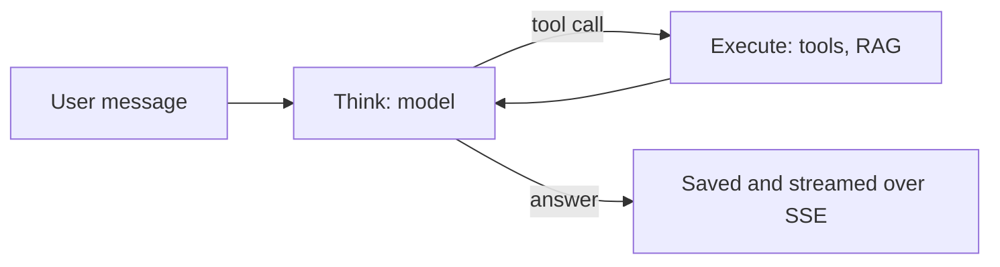

  <h1>Hi 👋, I'm Hanchen Wang</h1>
  <h3>Technical Project Manager · AI Agent Systems · Sydney</h3>
  
I decide what to build, and how to build it.

  
  
  

---

## 🎓 Education & 🏅 Awards

**The University of Sydney** · 2022–2026

- Bachelor of Advanced Computing (Honours) & Master of Computer Science
- Software Engineering · Data Science and Artificial Intelligence · WAM 80+
- **Dean's List of Excellence in Academic Performance**, 2025

---

## 🚀 Project Experience

### Project Manager · Hej, for Arc Intelligence

> A human–AI data-annotation platform where every released label can show how it was made.

<table>
<tr>
<td width="50%" valign="top">

#### 🗓️ Agile project management

Ran weekly Scrum around the client's meetings, University of Sydney capstone, 2026.

| | |
|---|---|
| 👥 Team | 8 |
| 🔁 Sprints | 7 weekly |
| 📋 User stories | 63 / 63 delivered |
| 🔀 Merged PRs | 96 |
| 🐞 Inherited defects | 30 / 30 closed |

🛠️ Also a developer: drafts, answer versions, the evaluation casebook's structure.

</td>
<td width="50%" valign="top">

#### ⚡ Performance optimization

- 🔍 **Found:** no slow query, only too many fast ones. A 200-item page sent 404 requests and ran 6,882 SQL statements.
- 🔧 **Fixed:** batched the reads and removed per-item repetition.
- 📈 **Result:**

| Page | Before → after | Requests |
|---|---:|---:|
| Annotate, 200 items | 3,390 → **571 ms** (5.9×) | 405 → 7 |
| Project page, 8 tasks | 119 → **49 ms** (−59%) | 13 → 6 |
| Dashboard, 51 projects | 519 → **89 ms** (−83%) | 107 → 9 |

</td>
</tr>
</table>

### Technical Lead · [ThinkXecAI](https://github.com/hanchen9127/ThinkXecAI)

> An open-source AI agent platform: it thinks, calls tools, searches its knowledge, and shows every step live.

<table>
<tr>
<td width="50%" valign="top">

#### 📐 Spec-driven development

Built **solo, from zero to v1.0**, strictly following **JetBrains' spec-driven development**: specs first, a written plan before every phase, then Claude Code builds to the spec, and every change passes a **double review: mine, then two reviewer subagents**.

| | |
|---|---|
| 🗓️ Idea → v1.0 | 12 weeks (Aug–Nov 2026) |
| 🧱 Build phases | 14, plus a UI redesign |
| ✅ Tests in CI | 975, plus an API contract check |

</td>
<td width="50%" valign="top">

#### 🧠 Technical choices and records

Java 21 · Spring AI · MyBatis · PostgreSQL + pgvector · React · SSE

Every decision is written down with its options and trade-offs: [67 decision records](https://github.com/hanchen9127/ThinkXecAI/tree/main/docs/adr). For example:

- **HNSW** vector index, so small knowledge bases still return correct results (ADR 003)
- **One run at a time per chat**, so tool results never interleave (ADR 042)
- **Read-only SQL on its own connection**, after a review reproduced a write (ADR 030)

</td>
</tr>
</table>

**🔜 In progress (version 2)**

- 🔎 **A deeper RAG system:** switchable retrieval modes. Naive vector search, Hybrid (vector + BM25 + a local re-ranker), and Agentic, where the agent plans its own searches and data queries.
- 📊 **Agent evaluation:** one benchmark for every mode, scoring retrieval, answers, tool use, and cost. The LLM judge is checked against DeepEval and hand labels.

---

## Also

| Project | What | Stack |
|---|---|---|
| [SupportGenerator](https://github.com/hanchen9127/SupportGenerator) | *Asiga project*: support structures for **3D-printing models** | Python · pytest |
| [factorised-MA-AIF](https://github.com/hanchen9127/factorised-MA-AIF) | *Honours research*: extended **multi-agent** active inference with Bayesian Model Reduction | Python · statistics |
| [GeneAnalysis](https://github.com/hanchen9127/GeneAnalysis) | *USYD project*: **ML classifiers** for kidney transplant outcomes, 636 patients | R · Shiny |

---

## 🔧 Tech Stack

  
  
  
  
  
  
  
  
  

<b>Where I used each skill</b>

| Skill | Where |
|---|---|
| Project management: Scrum, user stories, client management | Hej |
| Java, Spring AI, PostgreSQL + pgvector, React, AI agents, RAG | ThinkXecAI |
| Python, geometry algorithms, pytest | SupportGenerator |
| Active inference, Bayesian methods, statistical testing | factorised-MA-AIF |
| R, Shiny, machine-learning classifiers | GeneAnalysis |

